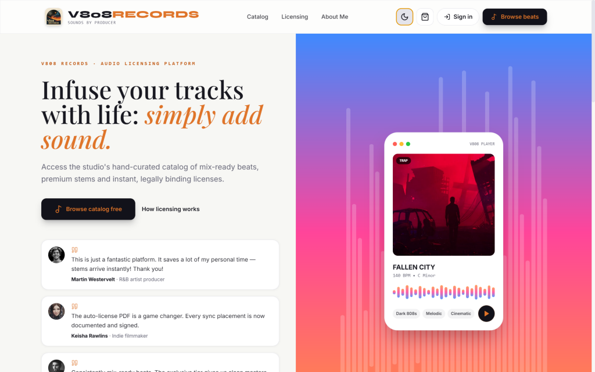
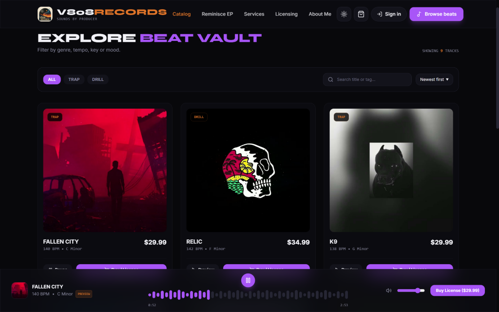
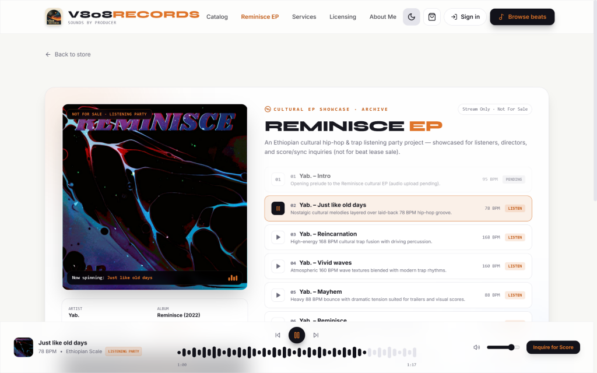
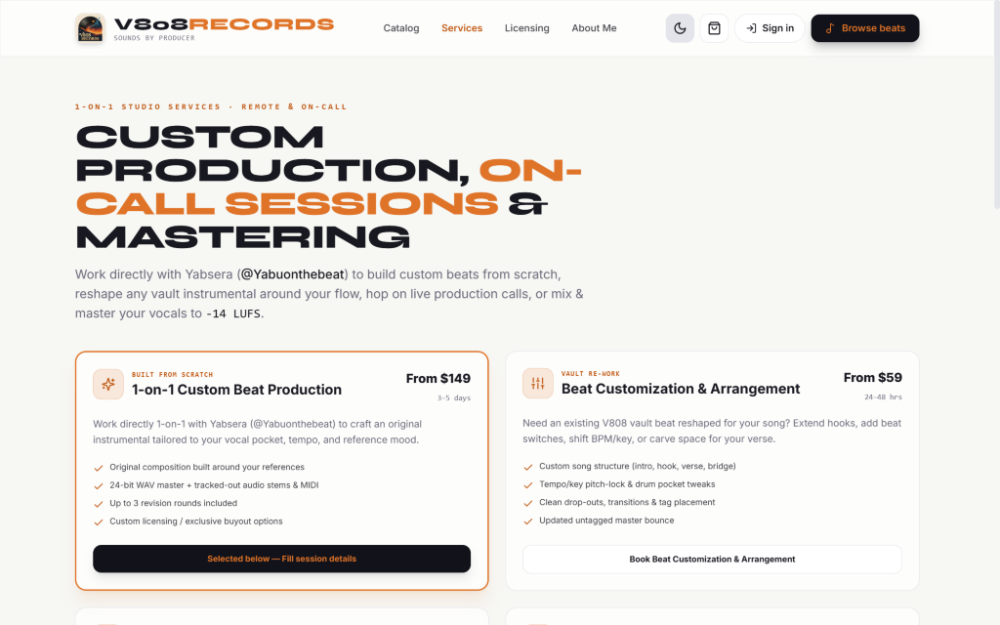
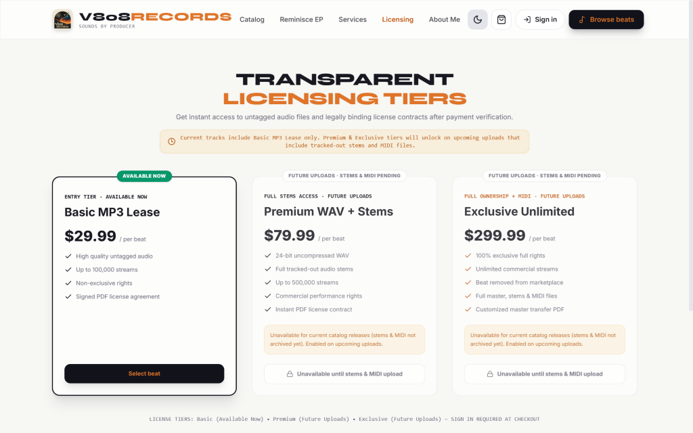
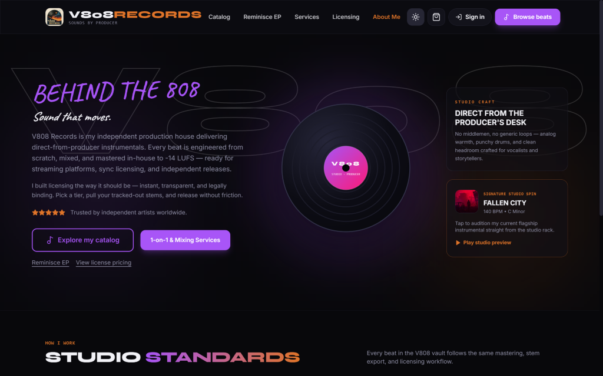

<div align="center">
  
  <h1>V808 Records</h1>
  <p>
    <strong>Beat Licensing Storefront, Multi-Gateway Checkout &amp; Cultural Listening Room</strong><br />
    Produced by <strong>Yabsera Teshome</strong> (<a href="https://www.youtube.com/@Yabuonthebeat">@Yabuonthebeat</a>)
  </p>
  <p>
    <code>React 18</code> · <code>TypeScript</code> · <code>Tailwind CSS</code> · <code>Vite</code> · <code>Supabase</code> · <code>Vercel Serverless</code>
  </p>
</div>

<p align="center">
  
</p>

---

## Overview

**V808 Records** is a full-stack audio licensing storefront and producer portfolio built to stream mix-ready instrumentals, showcase cultural archival releases, book 1-on-1 studio engineering sessions, and issue cryptographically signed beat licenses through both Ethiopian local payment rails and international gateways.

### Core Capabilities

- **Beat Vault & Persistent Waveform Player** — Stream 9 original Trap and Drill instrumentals sourced from `@Yabuonthebeat` with genre/BPM/key filtering, search, sorting, and a continuous bottom waveform player.
- **Tiered Licensing with Per-Beat Asset Gating** — Displays all three tiers (`Basic MP3 Lease`, `Premium WAV + Stems`, and `Exclusive Unlimited`) while automatically gating `Premium` and `Exclusive` until a release includes tracked-out stems and MIDI archives.
- **Ethiopian & International Multi-Gateway Payments** — Server-orchestrated checkout supporting **Chapa**, **Telebirr** (direct H5 WebPay or Chapa rail), **CBE / CBE Birr**, **Credit/Debit Cards (Visa, Mastercard, Amex via Stripe Checkout)**, and **PayPal Orders v2**.
- **Reminisce EP Listening Party** — Non-commercial archival showcase for the 2022 Ethiopian cultural hip-hop/trap EP (*Yab. — Reminisce*), featuring continuous queue playback (`SkipBack` / `SkipForward`), dedicated `LISTENING PARTY` player state, and direct **Inquire for Score** routing for film, documentary, and sync projects.
- **1-on-1 Studio Services & Session Booking** — Dedicated `/services` portal covering *1-on-1 Custom Beat & Score Production*, *Beat Customization & Arrangement*, *On-Call Live Production Sessions*, and *Vocal Mixing & -14 LUFS Mastering*, backed by a rate-limited booking endpoint.
- **Dual-Theme Design System** — Unified split-screen editorial hero across Light and Dark modes, paired with a techwear vinyl showcase on the `/about` page and `#DF7429` brand accents drawn from the V808 Records emblem.

---

## Visual Tour

### Beat Vault & Waveform Player (Dark Mode)
Filterable catalog grid (`ALL`, `TRAP`, `DRILL`), real YouTube cover artwork, and live waveform preview bar.



### *Reminisce* EP — Cultural Listening Party
Stream-only showcase (`Not For Sale`) with tracklist continuity, live spin indicator, and film/sync score inquiry routing.



### 1-on-1 Studio Services & Session Booking
Interactive service cards, catalog beat customization picker, and validated session inquiry form.



### Transparent Licensing Tiers
Clear pricing across all three tiers with honest per-track availability flags for stems and MIDI files.



### Producer Showcase & About Me (Dark Mode)
Techwear-inspired editorial layout featuring an interactive vinyl centerpiece, studio philosophy cards, and `-14 LUFS` engineering standards.



---

## Payment & Security Architecture

V808 Records enforces server-authoritative checkout and defense-in-depth across the client, serverless API, and database layers:

| Layer | Security Control | Implementation |
| --- | --- | --- |
| **Authentication** | Mandatory buyer sign-in + PKCE OAuth | Email/Password and Google OAuth (`flowType: 'pkce'`) via Supabase Auth; checkout is gated behind an authenticated session ([CheckoutModal.tsx](src/components/CheckoutModal.tsx), [AuthContext.tsx](src/context/AuthContext.tsx)). |
| **Server-Side Pricing** | Zero trust in client payloads | [api/payments/initialize.ts](api/payments/initialize.ts) resolves beat metadata, stem/MIDI eligibility, and USD/ETB amounts server-side after validating the user's Supabase JWT. |
| **Webhook Verification** | Cryptographic HMAC + replay window | [webhook-chapa.ts](api/payments/webhook-chapa.ts) and [webhook-stripe.ts](api/payments/webhook-stripe.ts) verify `HMAC-SHA256` signatures using `crypto.timingSafeEqual` and enforce a 300s timestamp window on Stripe events. |
| **Idempotent Fulfillment** | Ownership check & duplicate prevention | [api/payments/verify.ts](api/payments/verify.ts) enforces `user_id` ownership (IDOR defense), verifies payment directly with the gateway API, and issues one HMAC-signed row in `licenses`. |
| **Database RLS** | No client-side license forgery | [supabase/schema.sql](supabase/schema.sql) restricts `licenses` and `payment_orders` inserts/updates to `service_role`, includes a `prevent_role_escalation()` trigger on `profiles`, locks storage writes to `is_admin()`, and logs events in `audit_logs`. |
| **HTTP & CSP Headers** | Strict script execution & framing rules | [vercel.json](vercel.json) applies HSTS, `X-Frame-Options: DENY`, `X-Content-Type-Options: nosniff`, `Cache-Control: no-store` on `/api/*`, and `Content-Security-Policy` with `script-src 'self'` (externalized [theme-init.js](public/theme-init.js)). |

### Supported Payment Rails

| Gateway | Currency | Coverage | Handler |
| --- | --- | --- | --- |
| **Chapa Checkout** | `ETB` | Telebirr, CBE Birr, Amole, AwashBirr & Ethiopian cards | [api/_lib/providers.ts](api/_lib/providers.ts) |
| **Telebirr** | `ETB` | Direct Ethio Telecom H5 WebPay (or Chapa rail fallback) | [api/_lib/providers.ts](api/_lib/providers.ts) |
| **CBE / CBE Birr** | `ETB` | Commercial Bank of Ethiopia mobile & wallet transfer | [api/_lib/providers.ts](api/_lib/providers.ts) |
| **Stripe Checkout** | `USD` | Visa, Mastercard, Amex, Apple Pay & Google Pay | [api/_lib/providers.ts](api/_lib/providers.ts) |
| **PayPal** | `USD` | PayPal Orders v2 capture & express buyer protection | [api/_lib/providers.ts](api/_lib/providers.ts) |

---

## Project Structure

```text
v808-records/
├── api/                         # Vercel Node.js serverless endpoints
│   ├── _lib/
│   │   ├── providers.ts         # Chapa, Telebirr, Stripe, PayPal adapters
│   │   └── security.ts          # JWT auth, rate limiting, HMAC & license issuance
│   ├── payments/
│   │   ├── initialize.ts        # Authenticated server-side checkout creation
│   │   ├── status.ts            # Public gateway readiness booleans
│   │   ├── verify.ts            # Server-to-server order verification
│   │   ├── webhook-chapa.ts     # Chapa HMAC webhook handler
│   │   └── webhook-stripe.ts    # Stripe HMAC webhook handler
│   └── services/
│       └── book.ts              # Validated studio booking endpoint
├── docs/screenshots/            # Curated app screenshots used in documentation
├── public/
│   ├── beats/                   # Self-hosted .m4a catalog tracks
│   ├── covers/                  # High-resolution track cover artwork
│   ├── ep/                      # Reminisce EP cover art and .mp3 tracks
│   ├── logo.jpg                 # V808 Records primary brand emblem
│   └── theme-init.js            # Externalized theme initializer (CSP-compliant)
├── src/
│   ├── components/              # Navbar, PlayerBar, BeatCard, CheckoutModal, ReminisceSection
│   ├── context/                 # AuthContext, CatalogContext, PlayerContext, ThemeContext
│   ├── lib/                     # seed.ts (catalog, tiers, EP, services) & supabase.ts
│   ├── pages/                   # Home, Catalog, ListeningParty, Services, Licensing, About, Auth
│   │   └── admin/               # Dashboard, ManageBeats (stems/MIDI toggles), Orders
│   └── types.ts                 # Shared TypeScript interfaces
├── supabase/schema.sql          # Tables, triggers, RLS policies & storage buckets
├── vercel.json                  # SPA routing exclusions & HTTP security headers
└── .env.example                 # Required client & server environment variables
```

---

## Getting Started Locally

### 1. Install dependencies

```bash
npm install
```

### 2. Configure environment variables

Copy `.env.example` to `.env.local` for local development (when Supabase keys are omitted, the storefront runs in local preview mode with the bundled catalog):

```bash
cp .env.example .env.local
```

For full authentication and live payment processing on Vercel:

1. Execute [`supabase/schema.sql`](supabase/schema.sql) in your Supabase Dashboard SQL Editor.
2. Enable **Email** and **Google** providers under **Supabase → Authentication → Providers**.
3. Configure server-only secrets (`SUPABASE_SERVICE_ROLE_KEY`, `LICENSE_SIGNING_SECRET`, `CHAPA_SECRET_KEY`, `CHAPA_WEBHOOK_SECRET`, `STRIPE_SECRET_KEY`, `STRIPE_WEBHOOK_SECRET`, `PAYPAL_CLIENT_ID`, `PAYPAL_CLIENT_SECRET`, and optional `TELEBIRR_*`) in **Vercel Project Settings → Environment Variables**. Never prefix server secrets with `VITE_`.

### 3. Run & verify

```bash
npm run dev        # Start local Vite dev server (http://localhost:5173)
npm run typecheck  # Typecheck both src/ and api/ serverless functions
npm run build      # Build production bundle into dist/
```

---

## Producer & Contact

- **YouTube**: [@Yabuonthebeat](https://www.youtube.com/@Yabuonthebeat)
- **Instagram / Telegram**: `@yabuonthebeat` · `@v808_records`
- **Direct Inquiries**: `yabsera990@gmail.com`
